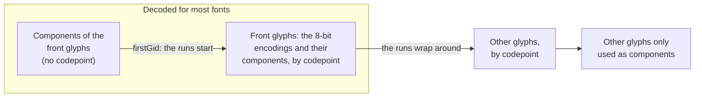

# Hellbox glyph data format (`.hbgd`), version 1

A `.hbgd` file only contains what's needed to synthesize a TrueType font:
font-wide metrics, a Unicode cmap, the advance widths and the quadratic
outlines (TrueType conventions: outer contours are clockwise, implied on-curve
points between two off-curve points). There's no hinting, no glyph names and
no layout tables.

All the multi-byte integers are big-endian.

- `varint`: unsigned LEB128 (7 bits per byte, least significant group first,
  high bit set on all the bytes but the last).
- `zigzag`: signed integer `v` stored as the varint `v >= 0 ? 2v : -2v - 1`.
- `string`: varint byte length followed by UTF-8 bytes.

## File

| Size | Field                                                      |
| ---- | ---------------------------------------------------------- |
| 4    | Magic: `HBGD` (`48 42 47 44`)                              |
| 1    | Version: `1`                                               |
| 1    | Compression: `0` none, `1` zlib (RFC 1950), `2` model codec |
| ...  | Payload, compressed according to the previous byte         |

The zlib format is what both `DecompressionStream("deflate")` and the pdf.js
`FlateStream` expect (the library only reads the model codec, and the
uncompressed files with its `encoder` feature). The model codec (see
[below](#model-codec)) is about 13% smaller than xz on the files of `data/`.

## Payload

| Type   | Field                                                        |
| ------ | ------------------------------------------------------------ |
| u16    | unitsPerEm                                                   |
| u8     | grid: all the coordinates and component offsets must be multiplied by it (1 for a lossless file) |
| u8     | flags: bit 0 serif, bit 1 fixed pitch                        |
| i16    | ascender (hhea)                                              |
| i16    | descender (hhea)                                             |
| i16    | lineGap (hhea)                                               |
| i16    | capHeight                                                    |
| i16    | xHeight                                                      |
| i16    | underlinePosition                                            |
| i16    | underlineThickness                                           |
| u16    | weightClass                                                  |
| u16    | stemV: thickness of the vertical stem of `l` (or `I`)        |
| u16    | stemH: thickness of the crossbar of `H`                      |
| u16    | refStemV: stemV of the other weight of the family (0 if unknown) |
| u16    | refStemH: stemH of the other weight of the family (0 if unknown) |
| varint | numGlyphs                                                    |
| string | family                                                       |
| string | version                                                      |
| string | copyright: the notices of all the source fonts, one per line |
| string | license                                                      |
| string | licenseURL                                                   |

Then 7 streams, each one being a varint byte length followed by its bytes, in
this order: `cmap`, `glyphs`, `advances`, `contours`, `flags`,
`coordinates`, `components`.

Keeping the different kinds of values in separate streams makes the
compression more efficient.

The stems are used to compute how much the outlines have to be emboldened (or
thinned) to look like another weight (or like a font with a given `StemV`).
The other weight of the family is the bold one (700) of a regular font (a
`weightClass` below 600), else the regular one (400).

### `cmap`

The glyphs come in this order: the glyphs only used as components by the
front glyphs, the front glyphs, the other glyphs, then the other glyphs only
used as components, the mapped glyphs being sorted by their first codepoint.
In the files of the families, the front glyphs are those of the characters of
the 8-bit font encodings of PDF (WinAnsi, Standard and MacRoman), and their
components: the glyphs are coded in order, so that a decoder needing only
them stops after them.



```
varint firstGid
varint runCount
runCount times:
  varint (start - previousEnd) mod 0x110000  (previousEnd is the end of the
                                              previous run + 1, 0 for the first
                                              run)
  varint end - start
varint aliasCount
aliasCount times:
  varint codepoint - previousCodepoint  (0 for the first alias)
  varint gid
```

A run maps the codepoints `start..end` to consecutive new glyph ids: the first
run starts at glyph `firstGid` (the glyphs before it are only used as
components), each run continuing where the previous one ended. The starts wrap
around: after the front glyphs, the runs start again from the lowest
codepoints. An
alias maps a codepoint to a glyph already used by a run (e.g. identical
glyphs in the source font).

### Per-glyph streams

For each glyph:

- `advances`: varint advance width (in font units, never quantized).
- `glyphs`: varint `info`:
  - `0`: empty glyph (e.g. a space).
  - even: simple glyph with `info / 2` contours.
  - odd: composite glyph with `(info - 1) / 2` components (at least one).

For each contour of a simple glyph, `contours` contains the varint number of
points minus one.

For each point of a simple glyph, `flags` contains one byte and
`coordinates` 1 to 4 bytes: the WOFF2 "triplet" encoding (see section 5.2 of
the [WOFF2 specification](https://www.w3.org/TR/WOFF2/#triplet_decoding)).
The high bit of the flag is set for off-curve points. The decoded values are
deltas from the previous point, the first point of a glyph being relative to
(0, 0); contours are concatenated.

For each component of a composite glyph, `components` contains:

```
varint header: gid * 4 + transform
zigzag dx
zigzag dy
transform 0: nothing
transform 1: i16 scale (F2Dot14)
transform 2: i16 xScale, i16 yScale (F2Dot14)
transform 3: i16 a, i16 b, i16 c, i16 d (F2Dot14)
```

A component point `(x, y)` becomes `(a * x + c * y + dx, b * x + d * y + dy)`:
point matching and the TrueType `SCALED_COMPONENT_OFFSET` flag are resolved
when the file is generated. Components can be composite glyphs themselves (the
decoder limits the depth to 8).

## Model codec

With the compression `2`, the payload is coded with an adaptive binary range
coder (same design as the LZMA one) driven by a context model of the glyph
data. The decoder gives back the very same payload bytes, which are then parsed
as described above. The coded data starts with a byte: the revision of the
model (currently 1), since the data can only be decoded with the same model.

The model is defined by `rust/src/model.rs`, whose code is shared by the
encoder (`rust/src/encoder/search.rs`) and the decoder: the same functions run
in both directions, the coder either writing the given values or returning the
decoded ones. That code is the specification of this codec; the main ideas
are:

- **Binary decisions** use adaptive probabilities (12 bits), averaged from two
  estimates adapting at different speeds, the adaptation being faster for the
  first decisions of a context. Integers are binarized with an adaptive Elias
  gamma code (with a binary tree for the first mantissa bits), whose length is
  coded with a binary tree for the long values (the magnitudes of the deltas,
  the ranks and the advances). For new-contour delta magnitudes, only the
  first mantissa bit is modeled. The remaining mantissa bits are coded as
  equiprobable values, without adaptive models.
- **Header, strings and cmap** are coded with simple byte and integer models.
- **Glyphs** are coded in order: type, outline or components, then the advance
  (same as the previous glyph, or predicted from the bounding box of the
  outline, or from the base glyph of a composite).
- **Contour dictionary**: all the contours coded so far are kept in
  move-to-front lists (one per number of points). Each contour is coded as:
  - *successor*: the contour which followed the previous contour the last time
    it was used (or the first contour of the previous glyph), at the predicted
    position: this captures the components made of several contours,
  - *reference*: an entry of the dictionary (a predicted one, i.e. the
    successor, the one before it, or the contour with the same index in the
    previous glyph, or the one with a given number of points and rank) whose
    deltas are either
    transformed (per-axis scale and optional shear, i.e. a 2x2 matrix) or
    blended with a second entry with the same topology (an interpolation, or
    extrapolation, between two versions of a contour, like the masters of a
    variable component), at a position (predicted from its last occurrence,
    or from the previous contour when both come from the same glyph), with
    optional corrections: either of each delta, or as the displacements of a
    few touched points, the other ones being interpolated like the IUP of the
    TrueType variations, then corrected by a residual,
  - *new*: point by point.

  The encoder chooses (it computes the exact cost of the best candidates by
  running the model without coding), the decoder just follows:

  ```mermaid
  flowchart TD
    contour(["Contour"]) --> successor{"Successor?"}
    successor -- yes --> copy["The entry which followed the previous<br/>contour, at the predicted position"]
    successor -- no --> reference{"Reference?"}
    reference -- yes --> entry["Entry: a predicted one,<br/>or number of points and rank"]
    entry --> blended{"Blended?"}
    blended -- yes --> blend["Second entry, blend factors"]
    blended -- no --> scaled{"Scaled?"}
    scaled -- yes --> scale["Per-axis scale,<br/>optional shear"]
    blend --> position["Position, from the predicted one"]
    scale --> position
    scaled -- no --> position
    position --> exact{"Exact?"}
    exact -- no --> iup{"IUP?"}
    iup -- yes --> touched["Touched points, interpolation,<br/>residuals"]
    iup -- no --> residuals["A correction per delta"]
    reference -- no --> new["New: point by point"]
  ```
- **New contours**: the on-curve flags and the deltas are coded with contexts
  made of the on/off-curve state of the last points, the zero/sign/magnitude
  class of the previous delta... In curves, the delta is predicted to be the
  previous one (the control polygon continues). Before each point, the most
  recent occurrence of the same context (the 4, 3, 2 or 1 previous deltas of
  the contour, hashed) gives a predicted point (LZP): a single decision tells
  if it's the right one, which makes the repeated parts of the outlines
  (serifs, stems...) cheap. When there's no such prediction, or a wrong one,
  the last two deltas can be a symmetric copy (rotated by 180°, or mirrored
  left-right or up-down, in the reverse order) of earlier ones, in the contour
  or in the history: the copy gives another predicted point, with its own
  decision.

  ```mermaid
  flowchart TD
    point(["Point"]) --> lzp{"LZP: the same context<br/>predicts it?"}
    lzp -- yes --> next(["Next point"])
    lzp -- "no, or no prediction" --> symmetric{"A symmetric copy<br/>predicts it?"}
    symmetric -- yes --> next
    symmetric -- "no, or no copy" --> coded["On-curve flag, then zero, sign<br/>and magnitude of dx and dy"]
    coded --> next
  ```
